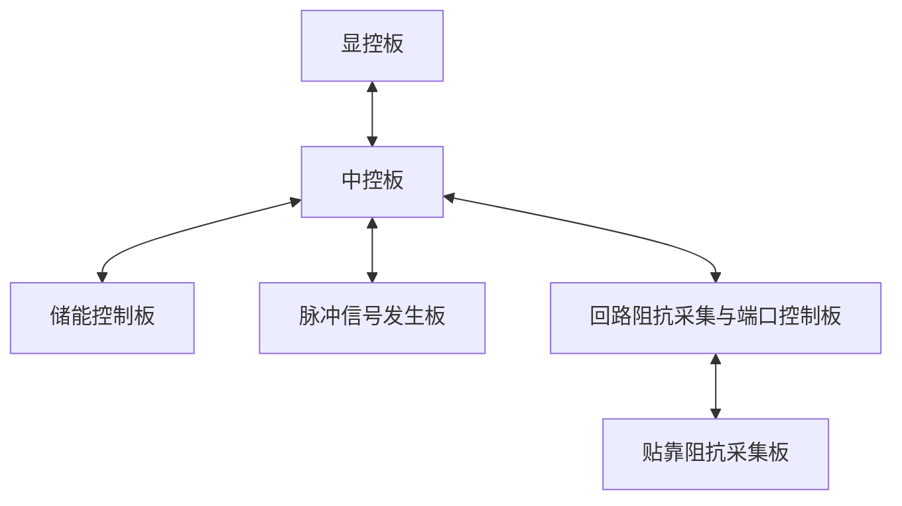

## 2.1 通信架构与角色

本产品中各板卡通信拓扑见图 2-1，各链路的通信角色见表 2-1。

**图 2-1 设备各板卡通信拓扑图**

**表 2-1 各板卡通信角色**

| 通信链路 | 主机 | 从机 |
| --- | --- | --- |
| 显控板 — 中控板 | 显控板 | 中控板 |
| 中控板 — 储能控制板 | 中控板 | 储能控制板 |
| 中控板 — 脉冲信号发生板 | 中控板 | 脉冲信号发生板（本板） |
| 中控板 — 回路阻抗采集与端口控制板 | 中控板 | 回路阻抗采集与端口控制板 |
| 回路阻抗采集与端口控制板 — 贴靠阻抗采集板 | 回路阻抗采集与端口控制板 | 贴靠阻抗采集板 |

本产品的产品地址为 0x03，各板卡的板卡地址以及物理层参数见表 2-2。

**表 2-2 各板卡地址**

| 板卡名称 | 板卡地址 | 接口类型 | 波特率 | 数据位 | 停止位 | 校验位 | 流控制 |
| --- | --- | --- | --- | --- | --- | --- | --- |
| 中控板 | 0x01 | UART（TTL 3.3V） | 115200 bps | 8 | 1 | 无 | 无 |
| 脉冲信号发生板 | 0x02 | UART（TTL 3.3V） | 115200 bps | 8 | 1 | 无 | 无 |
| 回路阻抗采集与端口控制板 | 0x03 | UART（TTL 3.3V） | 115200 bps | 8 | 1 | 无 | 无 |
| 储能控制板 | 0x04 | UART（TTL 3.3V） | 115200 bps | 8 | 1 | 无 | 无 |
| 贴靠阻抗采集板 | 0x05 | UART（TTL 3.3V） | 115200 bps | 8 | 1 | 无 | 无 |
